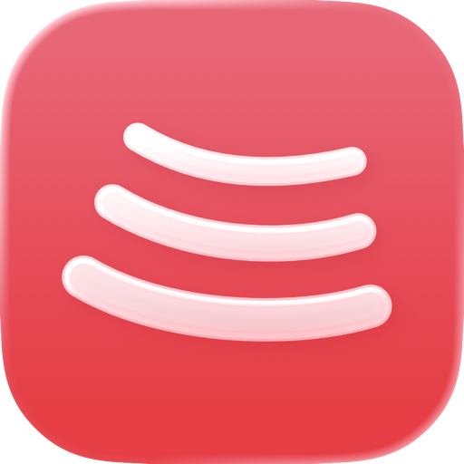

<div align="center">

<br/>



# BitChord for iOS

### A YouTube Music client for iPhone and iPad, ported from BitChord for Android

<br/>

[](https://github.com/Omi773/BitChord-iOS/releases/latest)
[](LICENSE)
[](#requirements)

<br/>

[Install](#install) · [Features](#features) · [Building from source](#building-from-source) · [Contributing](#contributing) · [Credits](#credits) · [Disclaimer](#disclaimer-and-legal-notice)

</div>

> [!IMPORTANT]
> BitChord is not affiliated with, endorsed by, or connected to YouTube, Google or Apple in any way. Use it at your own discretion.

---

## What this is

This repository holds the iOS port of [BitChord](https://github.com/kushagrasinghx/BitChord), the open-source YouTube Music client for Android by [Kushagra Singh](https://github.com/kushagrasinghx). It is a native SwiftUI app for iPhone and iPad that follows the Android app screen for screen, currently tracking BitChord for Android 1.8.

Where iOS cannot do what Android does, the port uses the closest iOS equivalent or leaves the feature out. The [porting notes](docs/PORTING.md) list each feature, the Android source it comes from, and the tests that cover it. The Android app remains the upstream project. Bugs in the iOS app belong here; bugs in the Android app belong [upstream](https://github.com/kushagrasinghx/BitChord/issues).

<!-- Screenshots: no iOS screenshots exist yet. Add them here once taken. -->

## Features

### Playback

- Search, browse and play the YouTube Music catalogue: Home, Explore, moods and genres, artist, album and playlist pages.
- Separate streaming quality for Wi-Fi and mobile data, plus a Dolby Atmos option.
- Optional add-on sources for lossless and Atmos streams, with YouTube Music as the fallback. Sources can be added, tested and reordered.
- Crossfade from 0 to 12 seconds, and Automix, which plans each transition from the beat grid and vocal activity of both tracks.
- Loudness normalization, skip silence, stereo widening and a built-in equalizer.
- A sleep timer: 15, 30, 45 or 60 minutes, or the end of the current track.
- An on-device song cache with an adjustable size limit.
- Stats for nerds on the now playing screen: codec, bitrate and the audio pipeline.

### Lyrics

- Synced lyrics with line and word highlighting, gathered from several providers: LRCLIB, Musixmatch, Genius, KuGou, PaxSenix, BetterLyrics, BiniLyrics, LyricsPlus, SimpMusic, Unison, Megalobiz and YouTube Music.
- Choose and reorder providers, adjust the timing offset, and translate lyrics into another language.
- Share selected lines as an image card.
- Lyrics are kept on the device per track.

### Library and offline

- Sign in with a Google account for your YouTube Music library, playlists and history. You can add several accounts and switch between personal and brand profiles.
- Download tracks for offline play, with metadata and lyrics written into the file.
- Play your own music from a folder you pick once: BitChord watches it and keeps the library in step as files are added, changed or removed. Lyrics (embedded, or a .lrc beside the file) and animated artwork work for these tracks too. Select songs the way the Files app does (tick circles on the left, two-finger drag to select a run) and delete them from the folder. Where a canvas source only has a square clip, the lock screen gets a 3:4 crop of it.
- Play music from SMB and WebDAV shares on your network.
- Export and import settings and listening history as a JSON file.

### Look and feel

- Animated cover art from Apple Music, Tidal, Spotify and a community index, on the player and on the lock screen.
- Player colours and background taken from the album artwork.
- A landscape player layout and iPad support.
- Five app icons to choose from in Settings.
- The interface is available in 16 languages.

### Social and integrations

- Listen Together: host a listening party and invite others with a code, a link or a QR code.
- Replay: listening statistics by period, with a shareable poster.
- Scrobbling to Last.fm and ListenBrainz.
- Discord Rich Presence with in-app Discord sign-in, showing the track, artist, progress and audio quality.

### System

- Lock screen and Control Center controls.
- Three Home Screen widgets, in small and medium sizes.
- A Share extension that opens YouTube and YouTube Music links in BitChord.
- App Intents for playback.
- A CarPlay interface. It needs Apple's CarPlay audio entitlement, which the project does not carry.

## Requirements

- iPhone or iPad running iOS 17 or later.
- A sideloading tool such as AltStore or SideStore. BitChord is not on the App Store.

## Install

BitChord is not on the App Store. The easiest way to install it, and to get every update, is to add the source to SideStore:

<p align="center">
  <a href="https://omi773.github.io/BitChord-iOS/sidestore.html"></a>
</p>

Or add this source URL yourself in SideStore (Sources, then +):

```
https://raw.githubusercontent.com/Omi773/BitChord-iOS/refs/heads/main/source.json
```

Each release on the [Releases page](https://github.com/Omi773/BitChord-iOS/releases/latest) also carries an IPA, `BitChord-<version>-unsigned.ipa`, for installing by hand.

1. Download the IPA from the latest release.
2. Open it in a sideloading app such as Feather, ESign, SideStore, AltStore or Sideloadly. It re-signs the app with your own Apple ID and installs it.

The IPA is not signed for your device, so it cannot be installed directly. To update, install the new version over the old one. Downloads, library and settings carry over.

## Building from source

### What you need

- A Mac with Xcode 27.
- An Apple ID if you want to run the app on a device. The simulator needs no signing setup.

### Open the project

```sh
git clone https://github.com/Omi773/BitChord-iOS.git bitchord-ios
cd bitchord-ios
open BitChord.xcworkspace
```

Open the workspace, not the `.xcodeproj`. It contains the app project and the `BitChordKit` package. Pick the `BitChord` scheme. Xcode resolves the two Swift package dependencies on first open.

### Signing for a device

The project uses automatic signing with no team set, and the maintainer's identifiers. To run on your own device:

1. Select your team under Signing & Capabilities for the `BitChord`, `BitChordWidgetExtension` and `BitChordShareExtension` targets.
2. Change the bundle identifiers to a prefix you own. The app is `com.music.bitchord`, the widget is `com.music.bitchord.widget` and the Share extension is `com.music.bitchord.share`. The extensions must keep the app's identifier as their prefix.
3. Change the app group `group.com.music.bitchord` in the three files under `App/Config/*.entitlements` and in `App/Shared/SharedConstants.swift`. The widget and the Share extension read the app's data through this group.

Do not commit these changes in a pull request.

### Optional keys

The app reads two optional build settings, `LASTFM_API_KEY` and `LASTFM_API_SECRET`, into its `Info.plist`. Without them the app builds and runs, but Last.fm sign-in and scrobbling and the genre chart in Replay stay unavailable. To use them, get a key from [Last.fm](https://www.last.fm/api/account/create) and pass both on the command line:

```sh
xcodebuild -workspace BitChord.xcworkspace -scheme BitChord \
  -destination 'generic/platform=iOS Simulator' \
  LASTFM_API_KEY=your_key LASTFM_API_SECRET=your_secret build
```

In Xcode, add them as user-defined build settings on the `BitChord` target, and keep them out of commits. No `.xcconfig` file is attached to the project.

The PaxSenix lyrics key is entered in the app under the lyrics sources, not at build time.

### Command line

The scripts in `scripts/` wrap the common builds. They can be run from any directory.

```sh
scripts/kit-test.sh                      # BitChordKit tests on the Mac, no simulator
scripts/kit-test.sh --filter LyricsTests # one module's tests
scripts/kit-build-ios.sh                 # compile BitChordKit for the iOS Simulator
scripts/app-build.sh                     # compile the app, extensions and test bundles
scripts/sim-test.sh                      # run the BitChord test plan on the "iPhone 16" simulator
scripts/make-ipa.sh                      # build an unsigned Release IPA in build/
scripts/verify-ipa.sh build/<file>.ipa   # check an IPA's signature and app-group entitlements
```

The scripts use `/Applications/Xcode.app` unless `DEVELOPER_DIR` is set. `JOBS=n` sets the number of parallel compile jobs. `BITCHORD_SIM_NAME` picks a different simulator for `sim-test.sh`, and extra arguments go to `xcodebuild`, for example `scripts/sim-test.sh -only-testing:BitChordTests`.

Tests that call real services are skipped unless `BITCHORD_LIVE_TESTS=1` is set, so the default run works offline.

## Project layout

```
BitChord.xcworkspace      open this
App/
  BitChord.xcodeproj      app, widget, Share extension and app-hosted test targets
  BitChord/               the SwiftUI app: screens, navigation, CarPlay, App Intents
  BitChordWidget/         Home Screen widgets
  BitChordShare/          Share extension
  Shared/                 code compiled into the app and both extensions
  BitChordTests/          app-hosted unit and view model tests
  BitChordUITests/        UI and end-to-end tests
  Config/                 Info.plists and entitlements
  BitChord.xctestplan     the scheme's test plan: BitChordTests and every BitChordKit test target
  BitChordE2E.xctestplan  the UI tests, some of which need the network
BitChordKit/              Swift package with all non-UI logic, one module per subsystem
  Sources/
    BitChordCore          shared models, settings, HTTP and logging
    InnerTube             YouTube Music API client, parser and Google sign-in
    StreamResolution      turns a video id into a playable audio stream
    Sources               add-on and JioSaavn sources, matching and fallback to YouTube
    PlaybackQueue         queue, shuffle, autoplay, history and sleep timer
    PlaybackPolicy        quality choice, upgrades, fallbacks and stats for nerds
    Playback              the AVPlayer engine, crossfade and system media controls
    AudioCache            on-disk cache for streamed audio
    AudioDSP              equalizer, loudness, skip silence and spatial audio
    Automix               transition planning with the beat and vocal models
    AutomixAnalyzer       C++ audio analyzer behind a C header
    Lyrics                lyrics providers, parsing, storage and translation
    Downloads             offline downloads, tagging and Files imports
    NetworkLibrary        SMB and WebDAV libraries
    ListenTogether        Listen Together client and invite links
    Integrations          Last.fm, ListenBrainz and Discord
    Replay                listening statistics and backup
    Canvas                animated cover art lookups
    Theming               colours taken from artwork
    BitChordTestSupport   test helpers, never shipped
  Tests/                  one test target per module
scripts/                  build, test and packaging scripts
docs/PORTING.md           feature checklist and porting decisions
```

The top of `BitChordKit/Package.swift` lists the Android source each module ports. Android paths in code comments are relative to `app/src/main/java/com/music/bitchord/` in the [upstream repository](https://github.com/kushagrasinghx/BitChord).

## Licence, privacy and contact

BitChord for iOS (this fork) is maintained by [](https://github.com/Omi773) and is free software under the [GNU General Public License v3.0](LICENSE). Copyright and licence notices are kept in [NOTICE.md](NOTICE.md) and [THIRD-PARTY-NOTICES.md](THIRD-PARTY-NOTICES.md).

- [Privacy Policy](PRIVACY.md)
- [Terms of Use](TERMS.md)
- [Contact](CONTACT.md): [omishikdr@gmail.com](mailto:omishikdr@gmail.com)

The same pages are in the app under Settings > About & legal.

## Contributing

Contributions are welcome. Read the [contributing guide](CONTRIBUTING.md) and the [code of conduct](CODE_OF_CONDUCT.md) before you open a pull request. Pull requests target `main`. For anything larger than a bug fix, open an issue first.

## Credits

### BitChord for Android

This app is a port of [BitChord](https://github.com/kushagrasinghx/BitChord) by [Kushagra Singh](https://github.com/kushagrasinghx), licensed under GPL-3.0. The design, the features and most of the behaviour come from that project, and the Android source is the reference for every module here. If you like the app, support the [upstream project](https://github.com/kushagrasinghx/BitChord).

Thanks also to the [contributors to BitChord for Android](https://github.com/kushagrasinghx/BitChord/graphs/contributors).

## Disclaimer and legal notice

BitChord for iOS is an independent, community-driven third-party audio player and client. It is not associated with Google LLC, YouTube, YouTube Music, Apple Inc. or any of their parent companies.

- **No media hosting.** BitChord does not host, upload or store copyrighted music. It plays files you import, files on your own network shares, and streams from public or user-authenticated APIs.
- **Fair use and API usage.** This software is made for personal research, education and fair use. You are responsible for making sure your use complies with your local copyright laws and the YouTube Terms of Service.
- **No guarantee of service.** BitChord does not guarantee that any third-party platform will keep working with it.
- **Copyleft.** BitChord is free software under GPL-3.0. Anyone may sell or redistribute copies, but every distribution must come with the corresponding source under the same license.

## License

BitChord for iOS is licensed under the [GNU General Public License v3.0](LICENSE). It is a port of BitChord for Android, which is GPL-3.0, so the port carries the same license. A few source files carry their own licence headers (AGPL-3.0, see [LICENSES/](LICENSES/AGPL-3.0.txt)); those headers must stay as they are. [THIRD-PARTY-NOTICES.md](THIRD-PARTY-NOTICES.md) has the full list.
